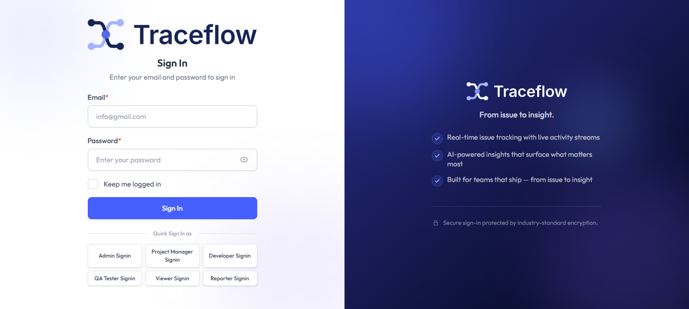
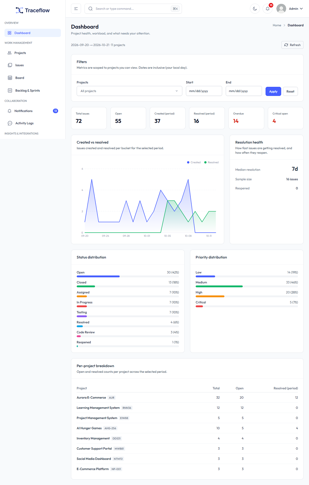
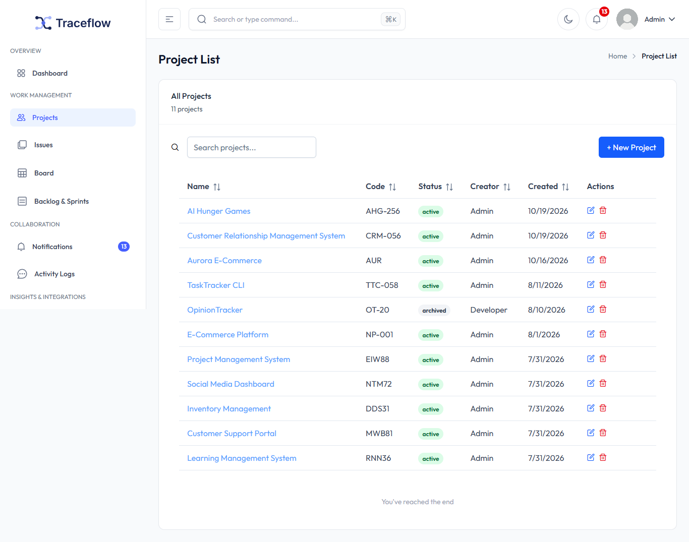
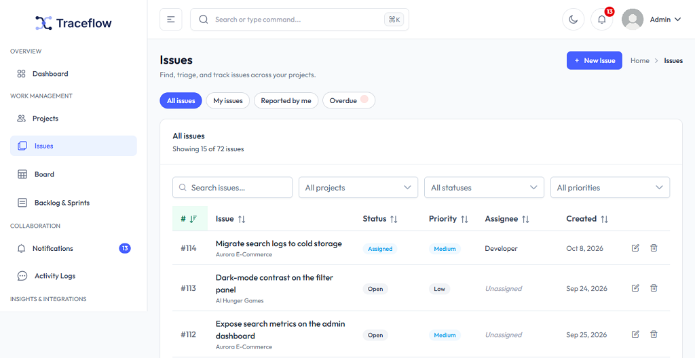
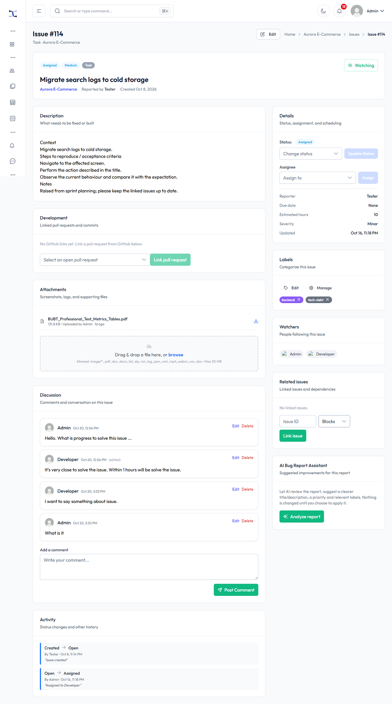
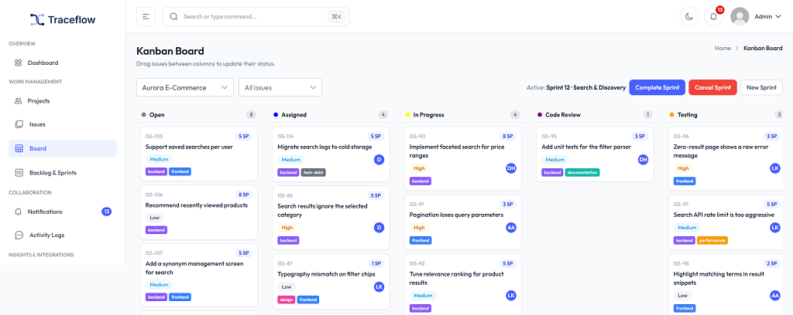
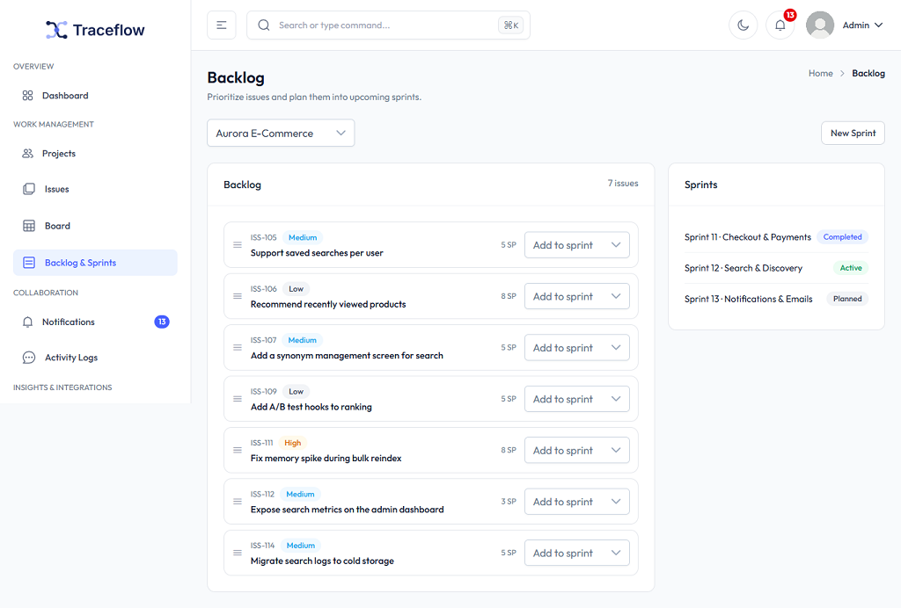
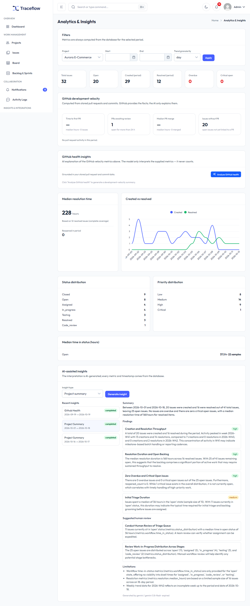
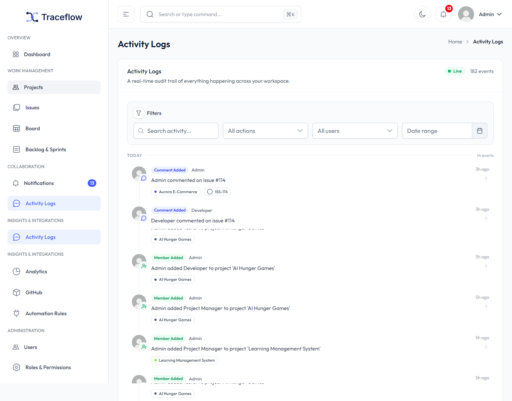
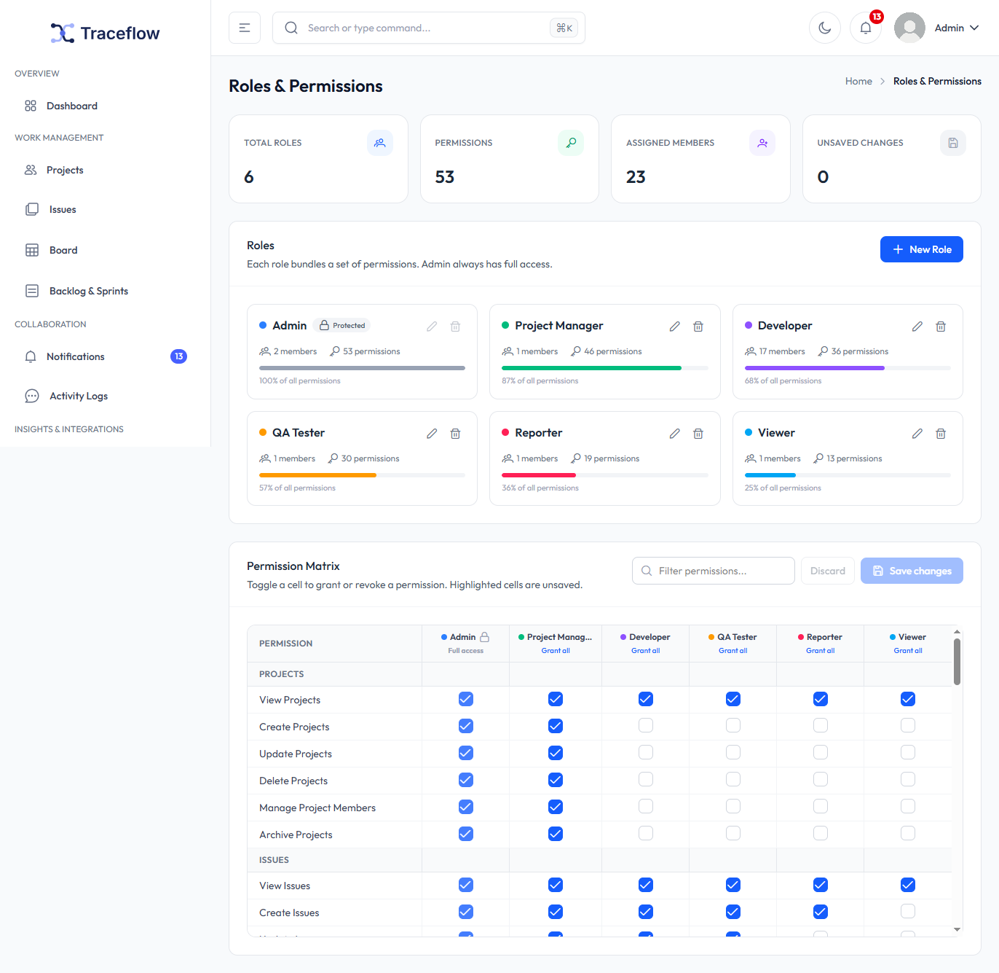

# Traceflow

**Traceflow** is a self-hosted, full-stack issue and bug tracking platform built with Laravel 13 and Vue 3. It helps engineering teams plan, track, and resolve work with structured workflows, agile boards, real-time collaboration, role-based access control, and complete auditability.

[](https://laravel.com)
[](https://vuejs.org)
[](https://php.net)
[](https://vitejs.dev)
[](LICENSE)

## Table of Contents

- [Overview](#overview)
- [Screenshots](#screenshots)
- [Key Features](#key-features)
- [Tech Stack](#tech-stack)
- [Architecture](#architecture)
- [Getting Started](#getting-started)
- [Environment Configuration](#environment-configuration)
- [Running the Application](#running-the-application)
- [Usage](#usage)
- [API Reference](#api-reference)
- [Real-Time Events](#real-time-events)
- [Permissions & Roles](#permissions--roles)
- [Data Model](#data-model)
- [Testing & Code Quality](#testing--code-quality)
- [Security](#security)
- [Roadmap](#roadmap)
- [Contributing](#contributing)
- [License](#license)
- [Author](#author)

## Overview

Traceflow brings structured issue tracking, agile project management, and team collaboration into one self-hosted application. Designed as an alternative to tools like Jira, Linear, and Bugzilla, it focuses on clarity, accountability, and real-time visibility across your engineering workflow.

Whether you're triaging bugs, planning sprints, or tracking feature requests, Traceflow provides the structure and audit trail needed to keep work organized from report to resolution.

## Screenshots

### Authentication


### Dashboard


### Projects


### Issue Tracking


### Issue Details


### Kanban Board


### Backlog & Sprints


### Analytics & Insights


### Activity Logs


### Roles & Permissions


## Key Features

### Project & Issue Management
- **Structured Issues** – Track bugs, features, tasks, and improvements with type, priority, severity, and status.
- **Workflow Engine** – Enforced state transitions with full status history and validation.
- **Agile Planning** – Kanban board, product backlog, and sprint management (start, complete, or cancel).
- **Issue Relationships** – Link related issues, apply labels, watch issues, and manage assignees.
- **Auto-Generated Keys** – Every issue receives a readable key (e.g., `ISS-{id}`) on creation.
- **Project Membership** – Organize teams with project-scoped access and roles.

### Collaboration & Communication
- **Threaded Comments** – Discuss issues with a full, traceable comment history.
- **File Attachments** – Upload, preview, and download files directly on issues.
- **Real-Time Updates** – Stay in sync with live updates via Laravel Reverb WebSockets.
- **In-App Notifications** – Get notified on assignments, comments, status changes, and mentions.
- **Activity Tracking** – Every action is recorded in an immutable audit trail.

### Security & Access Control
- **Authentication** – Secure token-based auth powered by Laravel Sanctum.
- **Role-Based Access** – Granular permissions via Spatie Laravel Permission.
- **Policy Enforcement** – Resource-level authorization for projects, issues, comments, and more.
- **User Management** – Admin controls for users, roles, and permissions.

### Integrations & Automation
- **GitHub Integration** – Link repositories, pull requests, and commits to issues.
- **Automation Rules** – Define triggers and actions to automate repetitive workflows.
- **AI-Assisted Insights** – Get AI-powered bug report analysis and project insights via the Laravel AI SDK.
- **Signed Webhooks** – Secure GitHub webhook ingestion with HMAC verification.

### Analytics & Reporting
- **Interactive Dashboard** – At-a-glance view of projects, issues, and team activity.
- **Project Analytics** – Track issue trends, workload distribution, and resolution metrics.
- **Audit Logs** – Full visibility into who did what and when across the system.

## Tech Stack

| Layer | Technologies |
| --- | --- |
| **Backend** | PHP 8.3, Laravel 13, Laravel Sanctum, Laravel Reverb, Spatie Laravel Permission, Laravel AI SDK |
| **Frontend** | Vue 3.5 (Composition API), Vite 6, Vue Router 4, Pinia 2, TypeScript, Tailwind CSS 4 |
| **UI Components** | PrimeVue 4, TailAdmin Vue, ApexCharts, vue3-apexcharts, vuedraggable |
| **Real-Time** | Laravel Echo, Pusher JS |
| **Database** | SQLite (default for local dev), MySQL, PostgreSQL |
| **Tooling** | Composer, npm, Laravel Pint, ESLint, Prettier, PHPUnit 12 |

## Architecture

```text
┌─────────────────────────────────┐
│           Vue 3 SPA             │
│   Pinia • Vue Router • Axios    │
└─────────────┬─────────┬─────────┘
              │ REST     │ WebSocket
              │           │ (Laravel Reverb)
              ▼           ▼
        ┌─────────────────────────┐   ┌─────────────────┐
        │      Laravel API        │   │  Laravel Reverb │
        │  Sanctum • Policies     │   │ Broadcast Server│
        │  Services • Events      │   └─────────────────┘
        └───────────┬─────────────┘
                    │ Dispatches Events
                    ▼
                ┌───────────┐   ┌───────────┐
                │  Database  │   │    Queue   │
                │ SQLite/MySQL│   │   Worker   │
                │ PostgreSQL  │   │ (optional) │
                └───────────┘   └───────────┘
```

- **Thin Controllers** – HTTP layer delegates to service classes that encapsulate business logic.
- **Event-Driven** – Domain actions dispatch events that are broadcast to authorized private channels.
- **Service Layer** – Core operations live in dedicated services (`IssueService`, `ProjectService`, `WorkflowService`, etc.).
- **Queue-Aware** – Notifications and broadcasts can be queued for better performance in production.

## Getting Started

### Prerequisites

| Tool | Version | Notes |
| --- | --- | --- |
| [PHP](https://php.net) | ≥ 8.3 | Extensions: `pdo`, `mbstring`, `openssl`, `tokenizer`, `xml`, `ctype`, `json` |
| [Composer](https://getcomposer.org) | ≥ 2.x | PHP dependency manager |
| [Node.js](https://nodejs.org) | ≥ 18.x (20 LTS recommended) | JavaScript runtime |
| [npm](https://www.npmjs.com) | Included with Node.js | Package manager |
| [Git](https://git-scm.com) | Latest | Version control |

### Installation

#### 1. Clone the Repository

```bash
git clone https://github.com/alsakib748/issue-bug-tracker.git
cd issue-bug-tracker
```

#### 2. Backend Setup

```bash
cd backend

# Install PHP dependencies
composer install

# Copy environment file and generate app key
cp .env.example .env
php artisan key:generate

# Create SQLite database (default)
touch database/database.sqlite

# Run migrations and seed default data
php artisan migrate --seed
```

#### 3. Frontend Setup

```bash
cd ../frontend

# Install Node dependencies
npm install
```

## Environment Configuration

### Backend (`backend/.env`)

Update these key values for local development:

```dotenv
APP_NAME="Traceflow"
APP_ENV=local
APP_URL=http://localhost:8000
APP_DEBUG=true

DB_CONNECTION=sqlite

SESSION_DRIVER=database
QUEUE_CONNECTION=database
BROADCAST_CONNECTION=reverb

# Laravel Reverb (WebSocket Server)
REVERB_APP_ID=traceflow
REVERB_APP_KEY=your-app-key
REVERB_APP_SECRET=your-app-secret
REVERB_HOST=localhost
REVERB_PORT=8080
REVERB_SCHEME=http

# CORS / Sanctum
SANCTUM_STATEFUL_DOMAINS=localhost:5173
FRONTEND_URL=http://localhost:5173

# AI (Optional)
AI_PROVIDER=gemini
AI_MODEL=gemini-3.6-flash
GEMINI_API_KEY=
```

> Generate secure Reverb credentials with `php artisan reverb:install` if needed. Never commit real secrets to version control.

### Frontend (`frontend/.env`)

Create a `.env` file in the `frontend/` directory:

```dotenv
VITE_API_URL=http://localhost:8000/api
VITE_BACKEND_URL=http://localhost:8000

VITE_REVERB_APP_KEY=your-app-key
VITE_REVERB_HOST=localhost
VITE_REVERB_PORT=8080
VITE_REVERB_SCHEME=http
```

Ensure `VITE_REVERB_APP_KEY` matches `REVERB_APP_KEY` from your backend configuration.

## Running the Application

Traceflow requires multiple services during development. Open four separate terminals from the project root:

| Terminal | Directory | Command | Purpose |
| --- | --- | --- | --- |
| 1 | `backend/` | `php artisan serve` | REST API at `http://localhost:8000` |
| 2 | `backend/` | `php artisan queue:listen` | Processes queued jobs (recommended for notifications) |
| 3 | `backend/` | `php artisan reverb:start` | WebSocket server at `ws://localhost:8080` |
| 4 | `frontend/` | `npm run dev` | Vite dev server at `http://localhost:5173` |

Once all services are running, open [http://localhost:5173](http://localhost:5173) in your browser.

### Production Build

```bash
# Optimize backend
cd backend
php artisan config:cache
php artisan route:cache
php artisan view:cache
php artisan optimize

# Build frontend
cd ../frontend
npm run build
```

Serve `backend/public` via your web server and deploy the contents of `frontend/dist/` as your SPA assets. Configure queues and Reverb as system services in production.

## Usage

### Default Account

If the database was seeded with `php artisan migrate --seed`, check the seeders in `backend/database/seeders/` for the default administrator credentials. Use those credentials to log in on first run.

### Core Workflow

1. **Create a Project** – Set up your workspace and invite team members.
2. **Report Issues** – Create bugs, tasks, or feature requests with proper metadata.
3. **Triage & Assign** – Prioritize work and assign issues to team members.
4. **Plan with Sprints** – Organize work in the backlog or move items to active sprints.
5. **Track Progress** – Use the Kanban board to move issues through your workflow.
6. **Collaborate** – Comment, attach files, and stay updated in real time.
7. **Close & Review** – Resolve issues, review activity logs, and track metrics in analytics.

## API Reference

All API routes are prefixed with `/api`. Protected routes require authentication via Laravel Sanctum. For the complete and up-to-date route definitions, refer to [`backend/routes/api.php`](backend/routes/api.php).

### Key Endpoints

| Category | Endpoints | Notes |
| --- | --- | --- |
| **Auth** | `POST /login`, `POST /logout`, `GET /user`, `GET /me/permissions` | Sanctum-based authentication |
| **Users** | `GET/POST /users`, `GET/PUT/DELETE /users/{user}`, `GET/PUT /user/profile` | User and profile management |
| **Projects** | `GET/POST /projects`, `GET/PUT/DELETE /projects/{project}`, member management routes | Project CRUD and membership |
| **Issues** | `GET/POST /issues`, `GET/PUT/DELETE /issues/{issue}`, transitions, assign, status actions | Core issue operations |
| **Comments** | `GET/POST /issues/{issue}/comments`, `PUT/DELETE /comments/{comment}` | Issue discussions |
| **Attachments** | `GET/POST /issues/{issue}/attachments`, `GET /attachments/{attachment}/download`, `DELETE /attachments/{attachment}` | File handling |
| **Agile** | `GET /board`, `GET /backlog`, Sprint CRUD endpoints | Kanban, backlog, and sprints |
| **System** | `GET /dashboard`, `GET/POST/PATCH/DELETE /notifications/*`, `GET /activity-logs/*` | Dashboard, notifications, and audit logs |
| **Integrations** | `POST /webhooks/github`, AI and automation endpoints | GitHub webhooks and automation |

### Example Request

```bash
curl -X POST http://localhost:8000/api/login \
  -H "Accept: application/json" \
  -H "Content-Type: application/json" \
  -d '{"email":"your-email@example.com","password":"your-password"}'
```

## Real-Time Events

Traceflow uses Laravel Reverb to broadcast domain events over private channels. Channel authorization is defined in [`backend/routes/channels.php`](backend/routes/channels.php).

| Event | Trigger | Channel(s) |
| --- | --- | --- |
| `IssueCreated` | New issue created | `project.{projectId}`, `issue.{issueId}` |
| `IssueUpdated` | Issue details updated | `project.{projectId}`, `issue.{issueId}` |
| `IssueAssigned` | Assignee changed | `project.{projectId}`, `issue.{issueId}`, `user.{assigneeId}` |
| `IssueStatusChanged` | Status transitioned/reopened/closed | `project.{projectId}`, `issue.{issueId}` |
| `CommentCreated` | Comment added to issue | `issue.{issueId}`, `project.{projectId}` |
| `AttachmentUploaded` | File attached to issue | `issue.{issueId}`, `project.{projectId}` |
| `AttachmentDeleted` | File removed from issue | `issue.{issueId}`, `project.{projectId}` |
| `NotificationCreated` | Notification generated | `user.{userId}` |
| `ActivityLogged` | Auditable action recorded | `project.{projectId}` |

## Permissions & Roles

Permissions are managed with Spatie Laravel Permission. Default roles typically include:

| Role | Access Level |
| --- | --- |
| **Admin** | Full system access including user, role, and permission management |
| **Project Manager** | Manage projects, members, sprints, and workflows |
| **Developer** | Work on assigned issues, comment, update statuses, and manage attachments |
| **QA Tester** | Report, verify, and test issues across projects |
| **Reporter** | Create and track issues within accessible projects |
| **Viewer** | Read-only access to assigned projects and issues |

Actual permissions may vary based on your seeded roles. Check `backend/database/seeders/` for the exact configuration.

## Data Model

Core entities in Traceflow:

| Entity | Purpose |
| --- | --- |
| `User` | Accounts with roles, permissions, and status |
| `Project` | Workspaces containing issues, members, and sprints |
| `ProjectMember` | Project-user relationship with role assignment |
| `Issue` | Work items with metadata, assignee, reporter, and workflow state |
| `IssueStatusHistory` | Complete history of status transitions |
| `Comment` | Threaded discussions on issues |
| `Attachment` | File uploads linked to issues |
| `Label` | Categorization labels for issues |
| `Sprint` | Time-boxed planning periods |
| `IssueLink` | Relationships between issues |
| `Notification` | User-specific in-app notifications |
| `ActivityLog` | Append-only audit trail of system actions |
| `AutomationRule` | Configurable automation definitions |

## Testing & Code Quality

### Backend

```bash
cd backend

# Run PHPUnit tests
php artisan test

# Format code with Laravel Pint
./vendor/bin/pint
```

### Frontend

```bash
cd frontend

# Lint with ESLint
npm run lint

# Format with Prettier
npm run format

# Production build check
npm run build
```

## Security

- **Environment Safety** – Never commit `.env` files or sensitive credentials. Use `.env.example` as a template.
- **Authentication** – All protected routes require valid Sanctum authentication.
- **Authorization** – Policies and permissions are enforced on all sensitive resources.
- **WebSocket Security** – Private channel subscriptions are authorized server-side.
- **Webhooks** – GitHub webhooks are verified with HMAC signatures.
- **File Uploads** – Validate and restrict uploaded files according to your security requirements.
- **Production Hardening** – Set `APP_DEBUG=false`, use HTTPS, restrict admin access, and keep dependencies updated.
- **Vulnerability Reporting** – If you discover a security issue, please report it privately by opening a security advisory on GitHub rather than creating a public issue.

## Roadmap

- [ ] Email and push notification support
- [ ] Issue templates and bulk import/export (CSV/JSON)
- [ ] Advanced saved filters and personalized dashboards
- [ ] Additional webhook integrations (Slack, Discord, Microsoft Teams)
- [ ] API key management for external integrations
- [ ] Docker and Docker Compose for one-command deployment
- [ ] Enhanced reporting and data export capabilities
- [ ] Dark mode refinements and accessibility improvements

## Contributing

Contributions are welcome! To get started:

1. **Fork** the repository
2. **Create** a feature branch: `git checkout -b feature/your-feature-name`
3. **Commit** your changes with clear, descriptive messages
4. **Test** your changes with linting and tests
5. **Push** to your branch and open a **Pull Request**

Please follow the existing code style, add tests where appropriate, and update documentation if your changes affect setup or usage. For significant changes, open an issue first to discuss your proposal.

## License

This project is licensed under the [MIT License](LICENSE).

## Author

**alsakib748** – [GitHub](https://github.com/alsakib748)

Built with Laravel, Vue, and a focus on practical, real-world engineering workflows.
